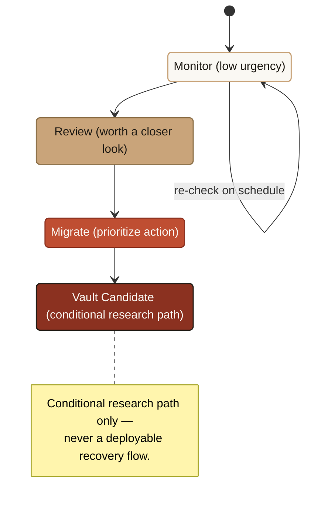

# Migration Readiness

Migration Readiness is the **recommend** step in WalletWall's workflow. Where the [Quantum Exposure Score](/features/quantum-intelligence) answers *how urgent is the risk*, Migration Readiness answers *how feasible is it to move safely, and what should be done first.*

It does not introduce a second score. It reuses existing wallet signals — value at risk, signature exposure, dormancy, and wallet structure — to recommend **one path** and place the wallet in a shared **risk tier**.

<Note>
  Keep three ideas distinct in all copy:
  **Quantum Exposure** = how urgent the wallet-level risk is.
  **Migration Readiness** = how feasible it is to move safely (this page).
  **Stablecoin Vault** = the flagship readiness journey and destination (`vault.walletwall.org` / `/stablecoin-vault`). The **Vault Simulator** (`/vault`) is the Sepolia testnet rehearsal detail, surfaced only from the Testnet Rehearsal outcome.
</Note>

## The shared risk tiers

Every assessment normalizes into one of four tiers. These are the common language across modules and reports.

| Tier | Meaning | What it suggests |
|---|---|---|
| **Monitor** | Low urgency — nothing to act on yet. | Keep watching signature exposure; re-check on schedule. No migration action needed. |
| **Review** | Worth a closer look and a plan. | Review the wallet and plan a migration approach — e.g. moving long-term holdings to a fresh wallet or splitting concentration. |
| **Migrate** | Prioritize concrete action. | Begin a real migration path: distribute signing across a multisig with an upgrade path, or coordinate a signer-led treasury plan. |
| **Vault Candidate** | Research path surfaced — conditional. | Review the WalletWall Vault research prototype as **one** experimental option. Monitor only in the private app. |

*Tiers are prioritization bands, not verdicts — "Migrate" means near the top of the migration queue, not unsafe today. "Vault Candidate" is always conditional; see [below](#why-the-vault-candidate-tier-is-conditional).*

## How recommendations should be interpreted

- **Tiers are prioritization bands, not verdicts.** "Migrate" means *near the top of your migration queue*, not *unsafe today*.
- **Recommendations are starting points.** They suggest a direction; the right migration for a given wallet depends on operational context WalletWall cannot see (signer availability, governance, and internal controls).
- **Confidence matters.** A recommendation made from partial or stale data carries caveats. Treat low-confidence recommendations as prompts to gather more information, not as final answers.
- **"Vault Candidate" is always conditional.** It is surfaced as a *research path*, never as a deployable recovery flow.

## Tier-by-tier actions

<Tabs>
  <Tab title="Monitor">
    Low exposure or low value at risk; often a wallet whose public key may not yet be revealed.

    - **Action:** Keep monitoring. No migration step is needed yet.
    - **Re-check** when value, activity, or exposure changes.
  </Tab>
  <Tab title="Review">
    Moderate-to-high exposure with meaningful value, or growing concentration.

    - **Action:** Review the wallet and plan an approach. Candidate paths:
      - `fresh-wallet` — move long-term holdings to a fresh wallet to reduce public-key exposure.
      - `split-wallet` — split holdings across wallets to reduce single-address concentration.
  </Tab>
  <Tab title="Migrate">
    High exposure or "Migration priority" — high value in a classical EOA with a feasible path.

    - **Action:** Begin a concrete migration. Candidate paths:
      - `multisig` — distribute signing across a multisig (e.g. Safe) with an upgrade path.
      - `treasury-custody` — coordinate a signer-led treasury migration path with the wallet's signers.
  </Tab>
  <Tab title="Vault Candidate">
    Long-horizon, high-value, quantum-exposed wallets where experimental migration approaches are relevant.

    - **Action:** Review the WalletWall Vault **research prototype** as one option, alongside the disclosure below. This never enables recovery flows, private key handling, seed phrase inputs, wallet writes, or mainnet interactions.
  </Tab>
</Tabs>

## Why the Vault Candidate tier is conditional

The **Stablecoin Vault** is a research prototype — the flagship vault readiness journey at `vault.walletwall.org` / `/stablecoin-vault`. It surfaces a four-outcome readiness recommendation (Monitor / Prepare / Testnet Rehearsal / Not Enough Data) and, for the Testnet Rehearsal outcome, opens the **Vault Simulator** (`/vault`) — a hybrid classical + post-quantum authorization rehearsal on Ethereum Sepolia.

The tier is surfaced as a *research path* because:

- The on-chain verifier in the Vault Simulator is an **architectural placeholder**, not production-grade cryptographic verification.
- The Vault Simulator is **testnet-only** (Ethereum Sepolia); mainnet writes are blocked.
- The Stablecoin Vault readiness journey is an informational, non-custodial assessment — it recommends a direction, not a deployable product today.

This is why "Vault Candidate" is conditional and research-oriented rather than a recommendation to move funds. See [Stablecoin Vault & Vault Simulator](/features/vault) for full detail.

## Read-only / no key-storage disclaimer

<Warning>
  WalletWall does not store keys and does not write to any wallet. Migration-readiness scanning is **read-only**: no wallet connection, no private keys, no seed phrases, no signing, no transactions. Recovery flows are not implemented yet. Recommendations are informational guidance for planning, not actions performed on your behalf, and not investment advice. The WalletWall Vault is a research prototype and must not be used for real funds.
</Warning>

The full non-custodial boundary — including the contract/guardian/passkey/MPC recovery model and the experimental post-quantum verifier status — is defined in the canonical [Key Management & Recovery Model](/security/key-management-recovery-model).

## See it move

Reading the tiers tells you what they are. [WallRoom](/wallroom) lets you change one
condition in a controlled synthetic world and watch which dependency moves and why the
migration conclusion follows — including the case where the honest answer is `UNKNOWN`.
It runs on invented data and assesses no real vault.

## Related

<Columns cols={2}>
  <Card title="WallRoom" icon="cubes" href="/wallroom">
    Change one condition in a synthetic world and see what moves.
  </Card>
  <Card title="Scoring Methodology" icon="function" href="/concepts/scoring-methodology">
    Factors, tiers, and a worked example.
  </Card>
  <Card title="Quantum Intelligence" icon="atom" href="/features/quantum-intelligence">
    The `deriveMigrationReadiness()` recommender and path definitions.
  </Card>
  <Card title="Stablecoin Vault & Vault Simulator" icon="vault" href="/features/vault">
    The flagship readiness journey and the Sepolia testnet rehearsal detail.
  </Card>
</Columns>
